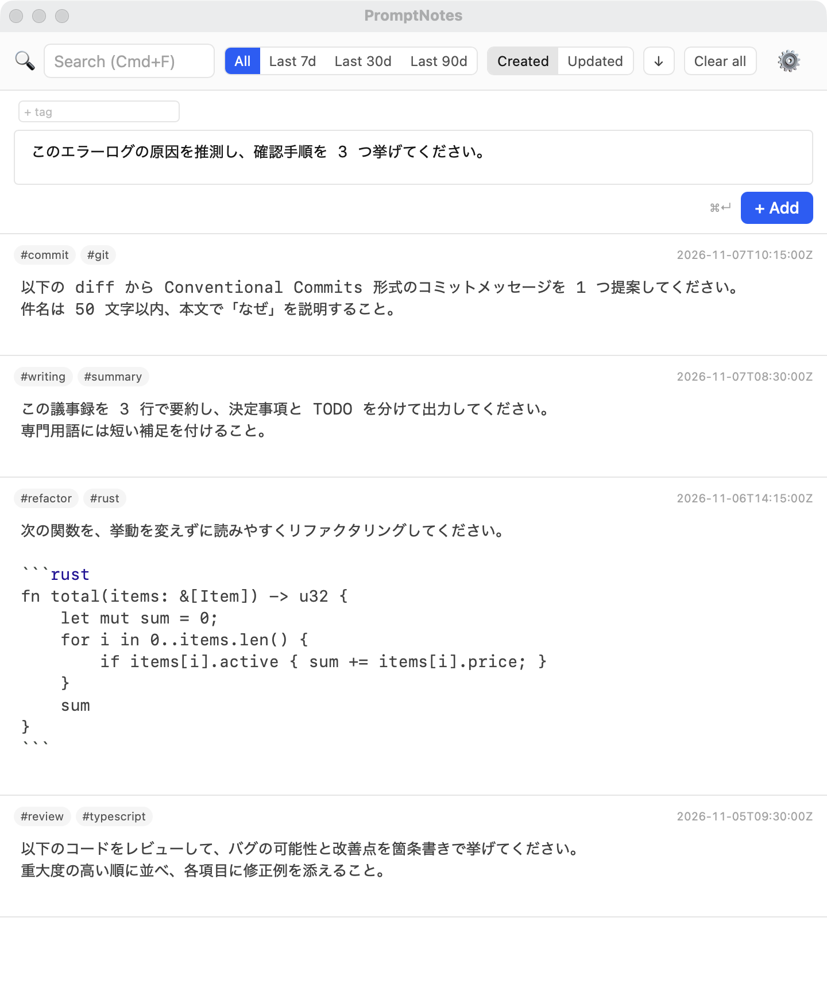
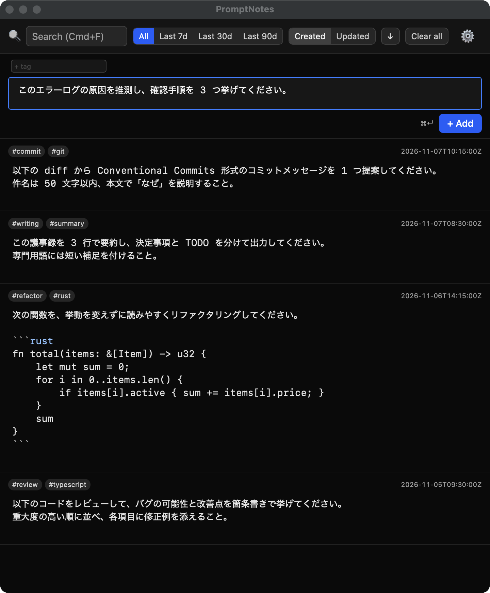

# promptnotes

[日本語](./README.md) | **English** | [简体中文](./README.zh-CN.md)

> [!NOTE]
> While promptnotes is at v0.x, the Japanese [README.md](./README.md) is the canonical version. This translation may lag behind it.

A desktop note app for collecting AI prompts and copying them out the moment you need them.
A place to keep the prompts you write.

> Ever pressed Enter in Claude Code or Codex and sent a prompt you hadn't finished?
> In Prompt Notes, Enter is safe to press.

Single pane, an always-on CodeMirror editor, and markdown saved locally as `.md` files.
Built with Tauri v2 / SvelteKit / Rust.

> See [idea.md](./idea.md) for the original concept and [.ori/domain/](./.ori/domain/) for the domain model (both in Japanese).

---

## Screenshots

<p align="center">
  
  
</p>

---

## Why Prompt Notes?

In Claude Code and Codex CLI, pressing Enter while typing a prompt sends it to the AI immediately.
Have you ever sent a half-written prompt by accident?

Prompt Notes is **a dedicated editor for writing prompts before you send them to an AI**.
Enter is just a newline. To send, press `Cmd+Enter` (or `Ctrl+Enter`).

Every note is stored as a local `.md` file, so it works alongside your other tools
and your data is never locked in.

---

## Features

- **Markdown editing**: syntax highlighting, list continuation, and bracket auto-closing via CodeMirror 6
- **Full-text search**: real-time search across note bodies and tags. `Cmd+F` / `Ctrl+F` focuses the search box
- **Tags**: tags live in the frontmatter; click one to filter
- **One-click copy**: copies only the note body to the clipboard (frontmatter and tags excluded)
- **Autosave**: saved as a `.md` file 500 ms after you stop typing
- **Filter & sort**: date range filter (7 / 30 / 90 days / all), sort by created or updated date

---

## Installation

Download from [GitHub Releases](https://github.com/dev-komenzar/promptnotes/releases).

| Platform | Format | Notes |
|---|---|---|
| macOS | `.dmg` | Homebrew support under consideration |
| Linux | AppImage / `.deb` / `.rpm` / Nix flake | Flatpak and Snap may be added if there is community demand |

### Launching on macOS

promptnotes is not enrolled in the Apple Developer Program, so it is not notarized.
Gatekeeper will show a warning on first launch. Use one of the following to get past it.

**Option A: Allow it in System Settings (macOS 15 Sequoia and later)**

On macOS 15 and later, right-click → "Open" no longer bypasses the warning.
1. Move `promptnotes.app` to `/Applications` and double-click it once. When the blocking dialog appears, click "Done" ("Move to Trash" deletes the app).
2. Open "System Settings > Privacy & Security" and click "Open Anyway" in the "Security" section near the bottom.
3. Authenticate with your administrator password (or Touch ID).
4. Open `promptnotes.app` again. A confirmation dialog appears; click "Open Anyway" there as well.

> On macOS 14 Sonoma and earlier, you can also right-click (control-click) `promptnotes.app` in Finder → "Open" → "Open" in the warning that follows.

**Option B: Remove the quarantine attribute from the terminal**
```bash
xattr -dr com.apple.quarantine /Applications/promptnotes.app
```

If Option A still shows "is damaged and can't be opened", run Option B (the app will then launch without warnings).

### Updates

promptnotes checks for a new version at launch and every 24 hours, and shows a notification (toast) when one is found.
You can also check manually at any time with **Check for updates** under "Updates" in Settings (the result is shown in Settings, and if a new version is available the two buttons below appear).

- **Update & restart**: downloads and installs the new version in place, saves the notes you are editing, then restarts. Available for macOS (.app / .dmg) and the Linux AppImage / deb / rpm builds. The deb / rpm builds ask for your administrator password during installation.
- **View release**: opens the release page. For formats that don't support automatic updates, such as Nix builds, update manually from there.

> **If you are on v0.2.3 or earlier**
> v0.2.2 / v0.2.3 do not check for updates at launch, so you won't be notified of new versions.
> Manually download a version that includes the update-check fix (v0.2.4 or later) from [GitHub Releases](https://github.com/dev-komenzar/promptnotes/releases/latest) and replace the app.
> From then on you will be notified automatically. Notes remain as `.md` files, so no data migration is needed.

---

## Development

### Quick start

The toolchain is pinned with a Nix flake.

```bash
direnv allow
cd apps/promptnotes
bun install
bun run dev
```

The Nix devShell is assumed. To build / test outside the devShell, you need system packages such as `libdbus-1-dev` ([docs/build.md §2.3](./docs/build.md#23-nix-devshell-外の-linux-非推奨), Japanese).

Build, test, and release procedures are in [docs/build.md](./docs/build.md) (Japanese).

### Tech stack

- **Desktop framework**: Tauri v2
- **Frontend**: SvelteKit (static adapter) + Vite + CodeMirror 6
- **Backend**: Rust (Tauri commands)
- **Testing**: Vitest (unit + component) / `cargo test` (Rust)
- **Package manager**: bun
- **Toolchain pinning**: Nix flake

### Project layout

```
.
├── apps/promptnotes/          # SvelteKit + Tauri app
│   ├── src/                   # frontend
│   └── src-tauri/             # Rust backend
├── .ori/                      # DDD distill documents (single source of truth)
├── docs/                      # supplementary docs
│   └── build.md               # build & release strategy
├── flake.nix                  # Nix devShell + package
└── idea.md                    # original concept (frozen)
```

---

## License

Not yet specified (personal project).
