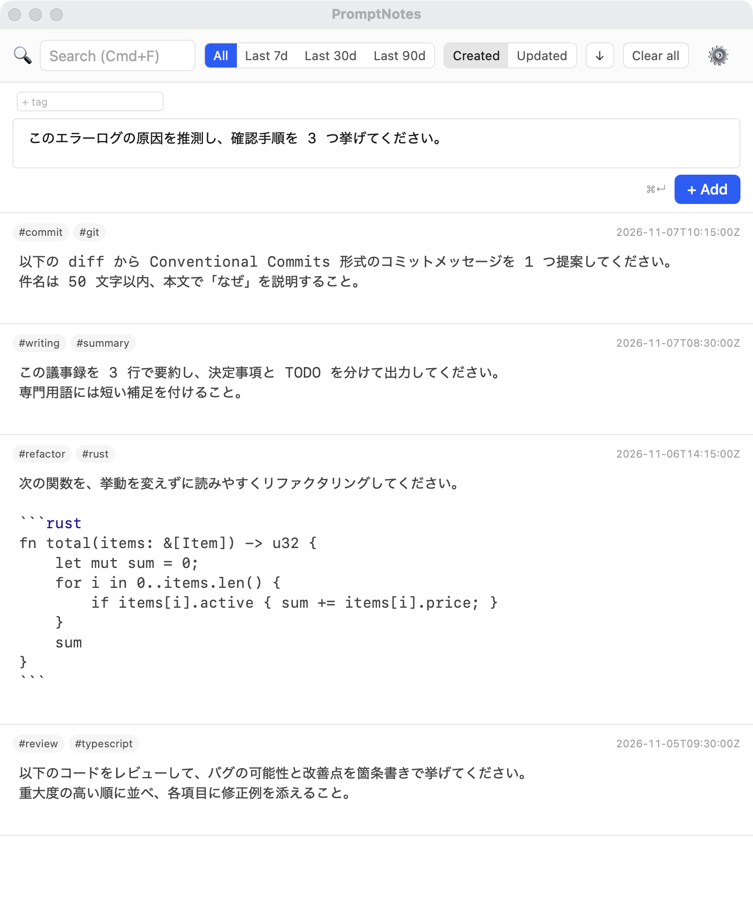
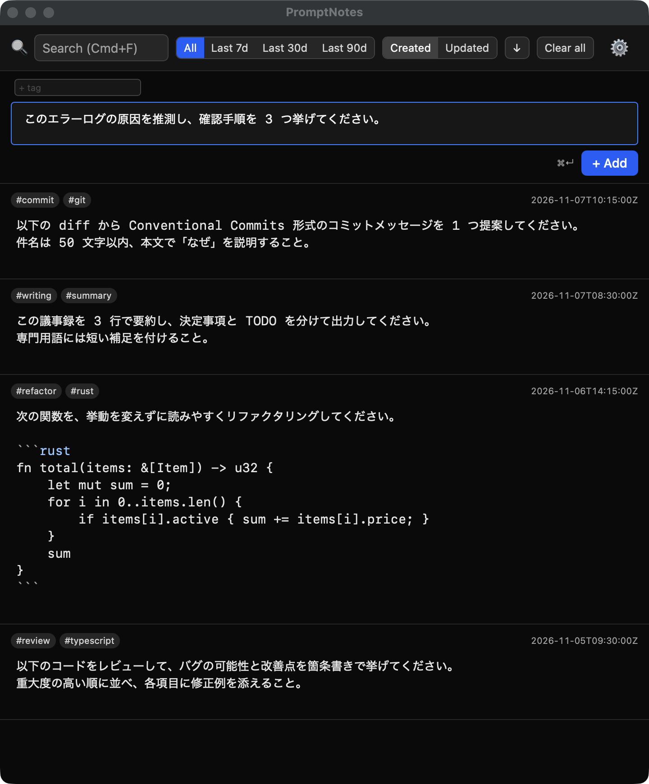

# promptnotes

AI プロンプトを書き溜め、すぐコピーして使うためのデスクトップノートアプリ。
プロンプトを書き溜めておく場所。

> Claude Code や Codex で Enter を押して意図せず送信してしまったことはありませんか？
> Prompt Notes なら、安心して Enter を押せます。

シングルペイン・CodeMirror 常時表示・markdown を `.md` ファイルとしてローカル保存。
Tauri v2 / SvelteKit / Rust 製。

> 構想の詳細は [idea.md](./idea.md)、ドメインモデルは [.ori/domain/](./.ori/domain/) を参照。

---

## スクリーンショット

<p align="center">
  
  
</p>

---

## なぜ Prompt Notes なのか

Claude Code や Codex CLI では、プロンプト入力中に Enter を押すと即座に AI へ送信されてしまいます。
書きかけのプロンプトをうっかり送信してしまった経験はありませんか？

Prompt Notes は **AI に送る前のプロンプトを書くための専用エディタ** です。
Enter は安心して改行に使えます。送信は `Cmd+Enter`（または `Ctrl+Enter`）。

また、すべてのノートはローカルの `.md` ファイルとして保存されるため、
他のツールと共存でき、データの持ち出しも自由です。

---

## 主な機能

- **Markdown 編集**: CodeMirror 6 によるシンタックスハイライト、リスト補完、ブラケット補完
- **全文検索**: 本文・タグをリアルタイム検索。`Cmd+F` / `Ctrl+F` で即フォーカス
- **タグ管理**: frontmatter でタグを管理、クリックでフィルタリング
- **ワンクリックコピー**: 本文のみをクリップボードにコピー（frontmatter・タグは除外）
- **自動保存**: キー入力後 500ms のデバウンスで `.md` ファイルとして自動保存
- **フィルター・ソート**: 期間フィルター（7日・30日・90日・すべて）、作成日／更新日ソート

---

## インストール

[GitHub Releases](https://github.com/dev-komenzar/promptnotes/releases) からダウンロードしてください。

| platform | 形式 | 備考 |
|---|---|---|
| macOS | `.dmg` | Homebrew 対応も検討中 |
| Linux | AppImage / `.deb` / `.rpm` / Nix flake | Flatpak, Snap はコミュニティ要望があれば追加検討 |

### macOS での起動

promptnotes は Apple Developer Program に登録していないため、公証 (notarization) されていません。
初回起動時に Gatekeeper の警告が出ます。以下のいずれかで回避してください。

**方法 A: システム設定から許可する（macOS 15 Sequoia 以降）**

macOS 15 以降では、右クリック →「開く」では警告を回避できません。
1. `promptnotes.app` を `/Applications` に移動し、一度ダブルクリックで開く。ブロックのダイアログが出たら「完了」を押す（「ゴミ箱に入れる」を押すとアプリが削除されます）
2. 「システム設定 > プライバシーとセキュリティ」を開き、下部の「セキュリティ」欄にある「このまま開く」を押す
3. 管理者パスワード（または Touch ID）で認証する
4. `promptnotes.app` をもう一度開く。確認ダイアログが出るので、そこでも「このまま開く」を押す

> macOS 14 Sonoma 以前では、Finder で `promptnotes.app` を右クリック（control + クリック）→「開く」→ 再度表示される警告で「開く」でも起動できます。

**方法 B: ターミナルから属性を解除**
```bash
xattr -dr com.apple.quarantine /Applications/promptnotes.app
```

方法 A を行っても「壊れているため開けません」と表示される場合は、方法 B を実行してください（実行後は警告なしで起動できます）。

### アップデート

起動時と 24 時間ごとに新しいバージョンを確認し、見つかった場合は通知 (toast) でお知らせします。
設定画面の「Updates」にある **Check for updates** からも、いつでも手動で確認できます（結果は設定画面内に表示され、新しいバージョンがあれば下の 2 つのボタンが表示されます）。

- **Update & restart**: その場で新しいバージョンをダウンロード・インストールし、編集中のノートを保存してから再起動します。macOS (.app / .dmg)、Linux の AppImage / deb / rpm 版で使えます。deb / rpm 版はインストール時に管理者パスワードを求められます。
- **View release**: リリースページを開きます。Nix でビルドした版など自動更新に対応していない形式では、こちらから手動で更新してください。

> **v0.2.3 以前をお使いの方へ**
> v0.2.2 / v0.2.3 には起動時の更新確認が組み込まれておらず、新しいバージョンが出ても通知されません。
> 更新確認の修正を含むバージョン (v0.2.4 以降) は、[GitHub Releases](https://github.com/dev-komenzar/promptnotes/releases/latest) から手動でダウンロードして入れ替えてください。
> 入れ替え後は、以降のバージョンから自動で通知されます。ノートは `.md` ファイルとして保存されたままなので、入れ替えによるデータ移行は不要です。

---

## 開発

### クイックスタート

Nix flake でツールチェーンを固定。

```bash
direnv allow
cd apps/promptnotes
bun install
bun run dev
```

Nix devShell の利用が前提。devShell 外で build / test する場合は system に `libdbus-1-dev` 等が必要 ([docs/build.md §2.3](./docs/build.md#23-nix-devshell-外の-linux-非推奨))。

ビルド・テスト・リリース手順は [docs/build.md](./docs/build.md)。

### 技術スタック

- **Desktop framework**: Tauri v2
- **Frontend**: SvelteKit (static adapter) + Vite + CodeMirror 6
- **Backend**: Rust (Tauri command)
- **テスト**: Vitest (unit + component) / `cargo test` (Rust)
- **パッケージマネージャ**: bun
- **ツールチェーン固定**: Nix flake

### プロジェクト構成

```
.
├── apps/promptnotes/          # SvelteKit + Tauri app
│   ├── src/                   # frontend
│   └── src-tauri/             # Rust backend
├── .ori/                      # DDD distill 文書 (single source of truth)
├── docs/                      # 補足ドキュメント
│   └── build.md               # ビルド・リリース戦略
├── flake.nix                  # Nix devShell + package
└── idea.md                    # 初期構想 (frozen)
```

---

## License

未設定（個人開発）。
