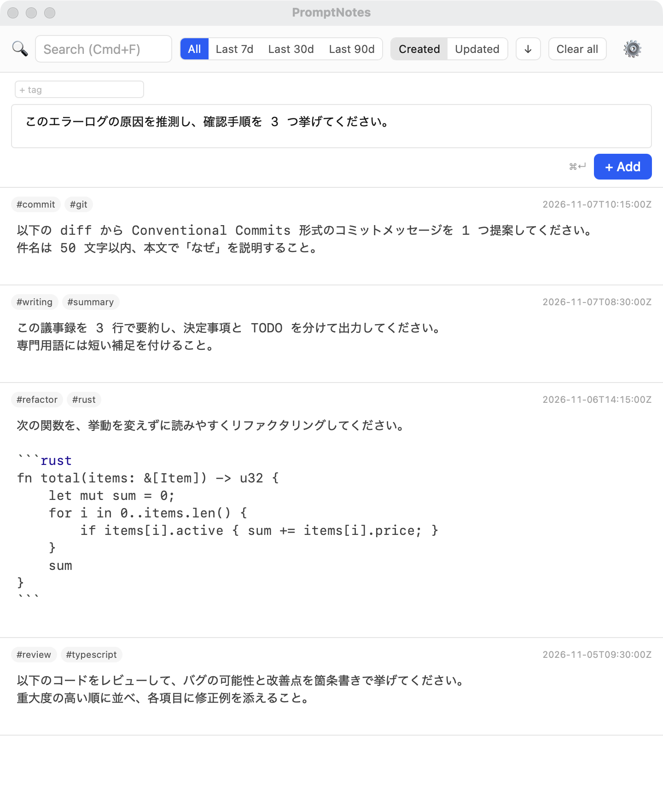
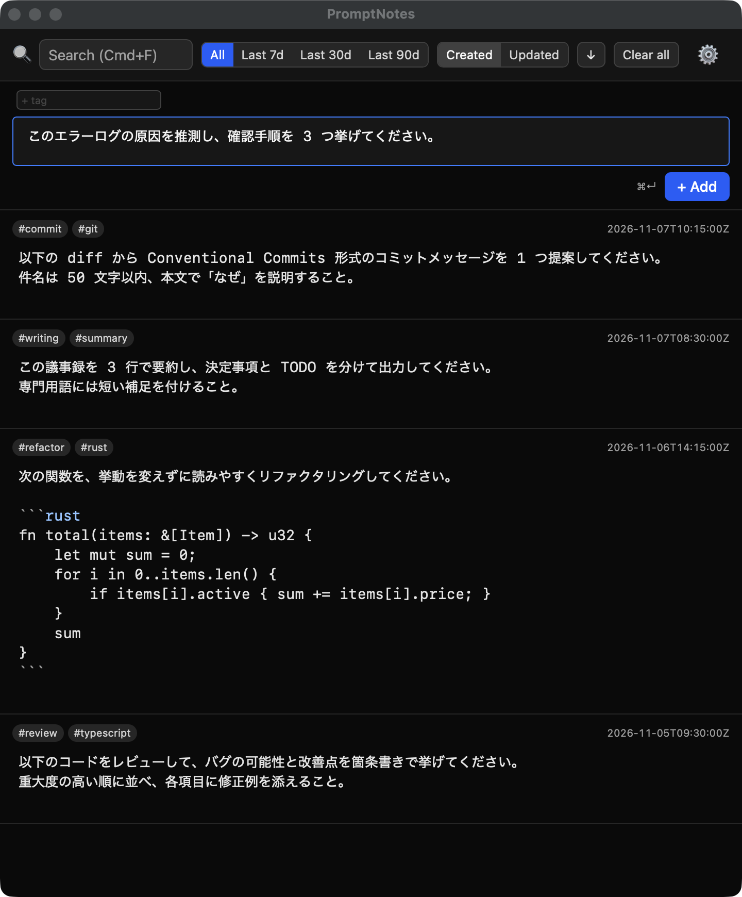

# promptnotes

[日本語](./README.md) | [English](./README.en.md) | **简体中文**

> [!NOTE]
> 在 v0.x 阶段，以日语版 [README.md](./README.md) 为准。本译文可能未及时同步最新内容。

一款用于积累 AI 提示词、需要时一键复制使用的桌面笔记应用。
一个存放你所写提示词的地方。

> 你是否曾在 Claude Code 或 Codex 中按下 Enter，结果把还没写完的提示词发了出去？
> 在 Prompt Notes 里，你可以放心地按 Enter。

单窗格、CodeMirror 编辑器常驻显示、markdown 以 `.md` 文件形式保存在本地。
基于 Tauri v2 / SvelteKit / Rust 构建。

> 最初的构想见 [idea.md](./idea.md)，领域模型见 [.ori/domain/](./.ori/domain/)（均为日语）。

---

## 截图

<p align="center">
  
  
</p>

---

## 为什么选择 Prompt Notes

在 Claude Code 和 Codex CLI 中，输入提示词时按下 Enter 会立即发送给 AI。
你是否也曾不小心把写到一半的提示词发送出去？

Prompt Notes 是 **专门用于在发送给 AI 之前撰写提示词的编辑器**。
Enter 只用于换行，可以放心使用。发送请按 `Cmd+Enter`（或 `Ctrl+Enter`）。

此外，所有笔记都以本地 `.md` 文件保存，
可以与其他工具共存，数据也可以自由迁移。

---

## 主要功能

- **Markdown 编辑**：基于 CodeMirror 6 的语法高亮、列表自动续写、括号自动补全
- **全文搜索**：实时搜索正文和标签。`Cmd+F` / `Ctrl+F` 即可聚焦搜索框
- **标签管理**：在 frontmatter 中管理标签，点击即可筛选
- **一键复制**：仅将正文复制到剪贴板（不含 frontmatter 和标签）
- **自动保存**：停止输入 500ms 后自动保存为 `.md` 文件
- **筛选与排序**：按时间范围筛选（7 天 / 30 天 / 90 天 / 全部），按创建日期或更新日期排序

---

## 安装

请从 [GitHub Releases](https://github.com/dev-komenzar/promptnotes/releases) 下载。

| 平台 | 格式 | 备注 |
|---|---|---|
| macOS | `.dmg` | 正在考虑支持 Homebrew |
| Linux | AppImage / `.deb` / `.rpm` / Nix flake | 如有社区需求，将考虑支持 Flatpak、Snap |

### 在 macOS 上启动

promptnotes 未加入 Apple Developer Program，因此未经过公证（notarization）。
首次启动时会出现 Gatekeeper 警告，请通过以下任一方法解决。

**方法 A：在系统设置中允许（macOS 15 Sequoia 及以上）**

在 macOS 15 及以上版本中，右键 →“打开”已无法绕过该警告。
1. 将 `promptnotes.app` 移动到 `/Applications`，双击打开一次。出现阻止对话框时点击“完成”（点击“移到废纸篓”会删除应用）
2. 打开“系统设置 > 隐私与安全性”，在底部“安全性”一栏中点击“仍要打开”
3. 输入管理员密码（或使用 Touch ID）进行认证
4. 再次打开 `promptnotes.app`。会出现确认对话框，在其中同样点击“仍要打开”

> 在 macOS 14 Sonoma 及更早版本中，也可以在访达中右键（按住 control 点击）`promptnotes.app` →“打开”→ 在随后出现的警告中点击“打开”来启动。

**方法 B：在终端中移除隔离属性**
```bash
xattr -dr com.apple.quarantine /Applications/promptnotes.app
```

如果执行方法 A 后仍提示“已损坏，无法打开”，请执行方法 B（之后即可无警告启动）。

### 更新

应用会在启动时以及每 24 小时检查一次新版本，发现新版本时会通过通知（toast）提示。
也可以随时在设置界面“Updates”中点击 **Check for updates** 手动检查（结果显示在设置界面中，如有新版本会出现下面两个按钮）。

- **Update & restart**：就地下载并安装新版本，保存正在编辑的笔记后重启。适用于 macOS（.app / .dmg）以及 Linux 的 AppImage / deb / rpm 版本。deb / rpm 版本在安装时会要求输入管理员密码。
- **View release**：打开发布页面。对于 Nix 构建版本等不支持自动更新的格式，请从这里手动更新。

> **致使用 v0.2.3 及更早版本的用户**
> v0.2.2 / v0.2.3 未内置启动时的更新检查，即使有新版本发布也不会收到通知。
> 请从 [GitHub Releases](https://github.com/dev-komenzar/promptnotes/releases/latest) 手动下载包含更新检查修复的版本（v0.2.4 及以上）并替换。
> 替换后，之后的版本都会自动通知。笔记仍以 `.md` 文件保存，替换时无需迁移数据。

---

## 开发

### 快速开始

使用 Nix flake 固定工具链。

```bash
direnv allow
cd apps/promptnotes
bun install
bun run dev
```

默认使用 Nix devShell。如需在 devShell 之外构建 / 测试，系统中需要安装 `libdbus-1-dev` 等依赖（[docs/build.md §2.3](./docs/build.md#23-nix-devshell-外の-linux-非推奨)，日语）。

构建、测试、发布流程见 [docs/build.md](./docs/build.md)（日语）。

### 技术栈

- **桌面框架**：Tauri v2
- **前端**：SvelteKit (static adapter) + Vite + CodeMirror 6
- **后端**：Rust (Tauri command)
- **测试**：Vitest (unit + component) / `cargo test` (Rust)
- **包管理器**：bun
- **工具链固定**：Nix flake

### 项目结构

```
.
├── apps/promptnotes/          # SvelteKit + Tauri 应用
│   ├── src/                   # 前端
│   └── src-tauri/             # Rust 后端
├── .ori/                      # DDD distill 文档（single source of truth）
├── docs/                      # 补充文档
│   └── build.md               # 构建与发布策略
├── flake.nix                  # Nix devShell + package
└── idea.md                    # 初始构想（已冻结）
```

---

## License

尚未设定（个人开发）。
